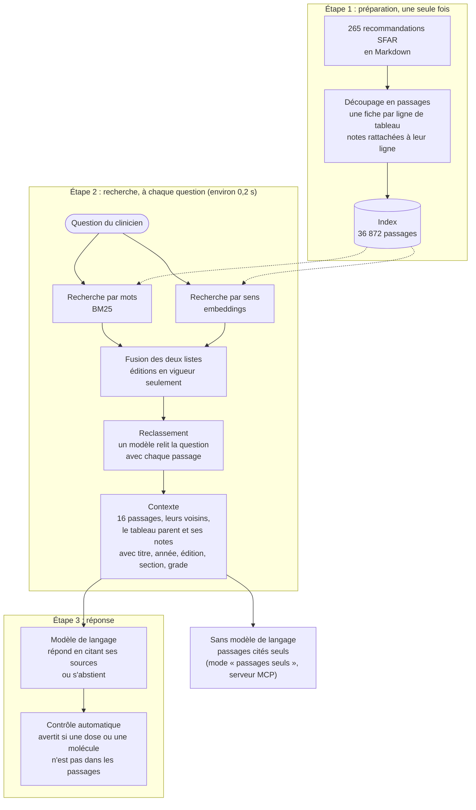

# RAG-SFAR : recherche citée dans les recommandations SFAR

> Datathon SFAR × InterHop 2026, projet [`rag-sfar`](https://datathon.sfar.org/projets/rag-sfar). Prototype de recherche, **non validé pour l'usage clinique**. Toujours relire le passage cité.

## Schéma du pipeline



| Étape | Ce qu'elle fait | Pourquoi |
|---|---|---|
| Découpage | Chaque recommandation est coupée en passages ; dans un tableau, chaque ligne devient une fiche qui garde ses en-têtes et ses notes | Une dose n'a de sens qu'avec son acte, sa population et sa note |
| Recherche par mots | Retrouve les passages qui contiennent les termes de la question | Fiable pour les noms de molécules, d'actes et les numéros de recommandation |
| Recherche par sens | Retrouve les passages proches par le sens, même sans mot commun | Rattrape les paraphrases et une partie des fautes de frappe |
| Fusion | Réunit les deux listes et écarte les éditions remplacées | Une recommandation périmée ne doit pas être servie comme en vigueur |
| Reclassement | Un second modèle relit la question avec chaque passage candidat et les reclasse | Plus précis que les deux recherches, mais trop lent pour tout le corpus |
| Contexte | Garde les 16 meilleurs passages, ajoute le passage voisin, le tableau parent et les notes de tableau, en 30 000 caractères au plus | Le modèle de langage doit voir la ligne entière et ses conditions |
| Réponse | Le modèle de langage répond en une à trois phrases citées, ou s'abstient | Chaque affirmation doit pouvoir être relue dans le passage cité |
| Contrôle | Signale une dose, une molécule ou une citation absente des passages | Avertissement pour le lecteur, sans modifier la réponse |

Ce schéma décrit la configuration évaluée (`C10_context_notes`). Deux options de robustesse aux sigles et aux fautes de frappe existent, éteintes par défaut (voir « Limites »). Les composants décrits dans d'anciennes versions de ce dépôt (fusion DBSF, boosts de métadonnées, module correctif « CRAG », ordre en U du contexte) n'en font pas partie : mesurés sans effet, ils sont désactivés.

## Ce que c'est

Un système RAG (« génération augmentée par recherche ») sur les recommandations de la SFAR :

1. **Recherche** dans 265 documents SFAR découpés en 36 872 passages (index `tas_v6`). Les éditions remplacées sont filtrées. La recherche combine une recherche par mots (BM25) et une recherche par sens (embeddings `multilingual-e5-small`), puis un modèle de reclassement (cross-encoder mmarco).
2. **Construction du contexte** : les 16 meilleurs passages, plus le passage voisin et le tableau parent des 8 premiers, et les notes de tableau appelées. Le tout tient en 30 000 caractères au plus, avec pour chaque source le titre, l'année, l'édition, la section, la population et la force de la recommandation. Cette configuration s'appelle `C10_context_notes` (tag git `retrieval-freeze-20261127`).
3. **Réponse** : un modèle de langage compatible OpenAI (cible : modèle ouvert ~30B sur LibreDataHub) répond en 1 à 3 phrases citées [S1], [S2]…, ou s'abstient si les passages ne traitent pas la question. Un contrôle automatique signale une dose, une molécule ou une citation absente des passages (avertissement seulement).

Interfaces : API web avec page de démonstration, API compatible OpenAI, serveurs MCP (stdio et HTTP) en lecture seule. Toutes servent le même profil `PRODUCTION`, celui qui a été évalué.

## Résultats vérifiés

Tous les chiffres viennent de `reports/FINAL_REPORT.md`, qui donne les sources, les définitions et les intervalles de confiance à 95 %.

**Réponses**, sur le benchmark des experts (antibioprophylaxie V3.1 ; questions validées par des médecins ; 69 questions de test tenues à l'écart). Le générateur est un substitut, Claude Sonnet, recevant exactement les prompts de notre configuration. Le juge est un LLM, Claude Haiku (grille v4, deux passes à l'aveugle), **non validé médicalement**.

| Test (69 questions) | Grilles du brouillon (pré-enregistré) | Grilles validées par un médecin (post hoc, mêmes réponses) |
|---|---|---|
| Réponses jugées correctes | 53,6 % [41–66] (37/69) | 62,3 % [50–74] (43/69) |
| Correctes ou partielles | 97,1 % [90–100] | 98,6 % [92–100] |
| Erreurs graves (au moins un juge) | 5,8 % [2–14] (4/69) | 2,9 % [0–10] (2/69) |

- **Erreurs graves** : toutes du type « conduite unique imposée alors que la population n'était pas précisée ». Aucune mauvaise molécule, mauvaise dose, conduite opposée ou édition périmée n'a été observée (0/69, intervalle exact 0–5,2 %).
- **Le dev était optimiste** : les réponses correctes y sont de 73,6 % (grilles du brouillon) et 77,8 % (grilles validées).
- **Le modèle qui serait déployé (~30B) n'a jamais été mesuré.**

**Recherche** : la suffisance des preuves est la part des questions dont toutes les preuves exigées sont dans le contexte.

| Jeu | Nature | Suffisance (ou passage de référence présent) |
|---|---|---|
| Benchmark des experts, test (64 questions évaluables) | validé par des médecins | 82,8 % [73–92] (dev : 95,8 %) |
| Même benchmark, formulations des cliniciens (variante en langage courant des experts) | publiée par les experts | 81,2 % au dev comme au test |
| `multirfe_synth` test (22 RFE jamais vues ; passage présent) | synthétique (LLM), non validé | 97,9 % |
| `genprobe` (47 RFE hors antibioprophylaxie) | synthétique (LLM), non validé | 77,1 % |
| `genprobe2` (49 RFE), questions à deux sources | synthétique (LLM), non validé | 40,0 % (8/20) |

Sur `multirfe_synth` test, les réponses sont correctes à 91,2 % [80,7–97,1] avec 0 erreur grave [0–6,3]. Ce jeu a été écrit, répondu et jugé par des modèles Claude : il surestime probablement Claude.

**Latence de recherche** : environ 190 ms par question sur un Mac M2 Pro (hors génération). La latence de génération du modèle cible n'a pas été mesurée.

## Limites

- Générateur évalué = substitut propriétaire, pas le modèle ouvert visé. Juge LLM non validé par un médecin.
- Faiblesses mesurées :
  - questions qui demandent deux sources (40 % de suffisance sur `genprobe2`) ;
  - lignes de tableau pédiatriques au test (69 % de suffisance) ;
  - réponses qui choisissent une population non précisée ;
  - fautes de frappe : −6 à −12 points de suffisance au dev.
- Les options de robustesse (lexicale : n-grammes de caractères et développement simple des sigles ; normalisation de la question par le modèle) et la décomposition des questions existent comme interrupteurs, désactivés par défaut. Aucune n'a d'effet démontré sur la sonde tenue à l'écart. Seule la normalisation par le modèle montre un effet sur des formulations réelles de cliniciens (variante en langage courant du benchmark validé, côté dev : +6,2 points de suffisance des preuves [+2,1 ; +11,5], aucune question perdue ; côté test, post hoc : +1,6 [0 ; +4,7]), mesuré avec Claude Haiku à la place du modèle servi.
- Démo et MCP :
  - aucun vrai générateur testé avec la page ;
  - image conteneur jamais construite ;
  - rien vérifié sur LibreDataHub ;
  - pas prêt pour un service public : pas d'authentification, pas de limitation de débit, droits sur les textes non réglés.
- Points cliniques à faire relire : `reports/A_VALIDER_MEDECINS.md` et `reports/lexique_a_valider_medecins.csv`.

Les chiffres publiés auparavant dans ce README (100 % sur 50 questions, 84 % en RAG naïf, 99,3 % d'evidence recall, plafond de 75 % des modèles frontier, projection 97–99 % pour 32B/72B) ne sont pas repris. Les uns n'ont pas été reproduits ou jamais mesurés. Les autres ont été obtenus sur des questions vues pendant le développement, avec des prompts écrits à partir de ces questions. Voir `reports/00_reproduction.md` et `reports/01_audit.md`.

## Installer

```bash
python3 -m venv .venv && source .venv/bin/activate
pip install -e ".[neural,dev,mcp]"
export HF_HUB_OFFLINE=1        # une fois les modèles e5-small et mmarco en cache
pytest -q
```

L'index `index/tas_v6` (environ 580 Mo) n'est pas versionné. Il se reconstruit avec `rag-sfar-index` (voir `reports/agents/B2_ingestion.md`).

## Lancer la démonstration

```bash
HF_HUB_OFFLINE=1 rag-sfar-serve --host 127.0.0.1 --port 8000
# générateur : RAG_SFAR_LLM_BASE_URL=https://…/v1 RAG_SFAR_LLM_MODEL=<modèle> RAG_SFAR_LLM_API_KEY=<clé>
```

Ouvrir http://127.0.0.1:8000/. Le mode « Passages seuls » fonctionne sans modèle de langage. Pour une instance accessible à d'autres, `RAG_SFAR_DEMO_LOCK_SETTINGS=1` est obligatoire. Guide complet : `reports/DEMO.md`.

## Lancer le serveur MCP

```bash
rag-sfar-mcp-http --port 8020                               # http://127.0.0.1:8020/mcp, santé sur /healthz
rag-sfar-mcp                                                # stdio
python scripts/mcp_smoke_test.py --url http://127.0.0.1:8020/mcp
```

Cinq outils en lecture seule (`sfar_search`, `search_sfar_recommendations`, `compare_sfar_editions`, `list_sfar_catalog`, `get_recommendation_sections`). Détails, conteneur (écrit, non testé) et liste de ce qui manque pour un service public : `reports/MCP_DEPLOIEMENT.md`.

## Reproduire l'évaluation

- **Guide pratique : `eval/BENCHMARKS.md`** (recherche seule, benchmark complet avec votre modèle compatible OpenAI, chaque option de robustesse, avec et sans l'ancien module CRAG ou la décomposition, branchement d'un évaluateur externe sur l'API, jugement).
- Protocole pré-enregistré : `eval/FINAL_EVAL_PROTOCOL.md` ; coffre-fort des jeux de test : `eval/LOCKBOX.md` ; format des jeux et adaptateur pour les benchmarks des experts : `eval/README.md`.
- Retrieval et génération (outil de rejeu) : `reports/agents/B3_generation.md` §1 et §6 bis. Exemple :
  ```bash
  .venv/bin/python eval_internal/gen_replay.py capture --suite abpe171 --configs C10_context_notes \
      --index-map table_aware_sota=tas_v6 --name c10notes_v6
  ```
- Jugement à l'aveugle en deux passes (`judge_io export-blind` puis `merge-blind`) : `reports/agents/J1_juge_v4.md` §4.
- Résultats : `reports/eval/judge_v4/blind_final/summary.md` ; grilles validées : `reports/eval/judge_v4/blind_v31grid2/combined_validated_grid.md`.
- Le benchmark des experts n'est pas redistribué ici. Il se convertit localement avec `python -m rag_sfar.evaluation.datasets convert-enriched`.

## Où sont les rapports

| Document | Contenu |
|---|---|
| `reports/FINAL_REPORT.md` | rapport final : résultats, erreurs graves, faiblesses, résultats négatifs, écarts au protocole |
| `reports/COMPARAISON_SOLUTIONS.md` | comparaison des stratégies mesurées et de ce qui n'a pas été mesuré |
| `reports/README.md` | index de tous les rapports |
| `reports/A_VALIDER_MEDECINS.md` | points de sécurité clinique à faire relire |
| `reports/agents/` | rapports détaillés de chaque chantier (retrieval, ingestion, génération, juge, robustesse, revues indépendantes) |
| `eval_internal/README.md` | jeux internes : synthétiques, non validés médicalement, outils de développement seulement |
| `JOURNAL.md` | journal daté de toutes les décisions et mesures |
