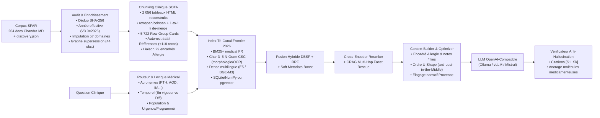

# RAG-SFAR — Pipeline RAG & Serveur MCP State-of-the-Art sur les Recommandations SFAR

> **Datathon SFAR × InterHop 2026** — Projet [`rag-sfar`](https://datathon.sfar.org/projets/rag-sfar)  
> Fiabilisation, traçabilité et évaluation scientifique des LLM sur les **264 recommandations cliniques de la SFAR (2000–2026)**, conçu nativement pour **LibreDataHub** (Ollama / vLLM / PostgreSQL + `pgvector` / Jupyter) et interopérable avec les projets [`benchmark-enrichi`](https://datathon.sfar.org/projets/benchmark-enrichi) et [`plateforme-evaluation`](https://datathon.sfar.org/projets/plateforme-evaluation).

---

## Architecture du Pipeline



---

## Découvertes Clés de l'Audit Forensique du Corpus

L'analyse systématique des 267 fichiers (`discovery.json` + sorties OCR Chandra) révèle **6 pièges majeurs** que tout pipeline RAG naïf échoue à gérer :

1. **100 % des tableaux sont en HTML `<table>` (2 056 tableaux, 0 tableau pipe Markdown)** et **49,1 %** (1 011 / 2 060 — jusqu'à **64,5 %** dans l'Antibioprophylaxie V3.0 !) sont des **continuations sans `<thead>` sur page suivante**. Notre parseur ([table_parser.py](src/rag_sfar/ingestion/table_parser.py)) résout tous les `rowspan`/`colspan`, propage les en-têtes entre pages et génère des **Row-Group Cards** atomiques.
2. **25,4 % du corpus (5,89 millions de caractères)** sont de pures bibliographies (`Références`) qui polluent massivement le retrieval lexical et sémantique. Elles sont isolées et exclues par défaut.
3. **Piège critique des métadonnées manquantes** : **57 documents** ont `subdomain = None`, incluant **les 3 RFE phares 2026** (Antibioprophylaxie V3.0, Infections Intra-Abdominales 2026, Anticoagulants 2026). Tout filtre strict `subdomain == "Infectiologie"` exclut silencieusement les versions 2026 et renvoie les éditions obsolètes 2015/2018 ! Nous imputons les domaines canoniques et utilisons un **soft metadata boost**.
4. **44 éditions historiques remplacées** (2000–2021) cohabitent avec les éditions en vigueur (2024–2026), avec en prime des **écarts de périmètre clinique** critiques (ex : Anticoagulants *procédure programmée* 2026 vs *urgence* 2024 qui restent toutes deux en vigueur !). Notre graphe de supersession ([loader.py](src/rag_sfar/ingestion/loader.py)) filtre par défaut les versions périmées tout en activant automatiquement le mode multi-éditions sur les questions comparatives (« qu'est-ce qui a changé entre 2018 et 2026 ? »).
5. **Le problème de l'encadré allergie séparé (*Split-Chunk Allergy Box*)** : dans l'Antibioprophylaxie V3.0, l'acte chirurgical (ex : PTG → Céfazoline) et l'encadré allergie de la spécialité (→ Clindamycine / Vancomycine) sont séparés de plusieurs pages. Notre **Context Builder** relie automatiquement chaque ligne de tableau à l'encadré allergie de sa spécialité exacte.
6. **Traductions anglaises (24 docs) & résumés anglais en page 1** : la détection de langue sur le corps central (20 %–80 %) évite les faux positifs sur les articles français à abstract anglais tout en filtrant les doublons purement anglophones.

---

## Démarrage Rapide

### 1. Installation locale (Mac / Linux / LibreDataHub)
```bash
python3 -m venv .venv
source .venv/bin/activate
pip install -e ".[neural,dev]"
cp .env.example .env
```

### 2. Commandes CLI principales
```bash
# Audit forensique du corpus SFAR -> reports/corpus_audit.{md,json}
rag-sfar-audit

# Construction d'un index hybride (BM25+ médical + Dense multilingue)
rag-sfar-index --strategy table_aware_sota --output-dir index/table_aware_sota

# Suite d'ablation scientifique (C0 naïf -> C7 SOTA) sur 171 ABP + 30 Multi-RFE
rag-sfar-eval --index-root index --output-dir reports

# Serveur Démonstrateur Web Clinique + API OpenAI-compatible (/v1/chat/completions)
# Option A : Mode LibreDataHub (Ollama / vLLM / Mistral via .env)
rag-sfar-serve --index-dir index/table_aware_sota --port 8000
# Option B : Mode 100 % Local Apple Silicon GPU (Qwen2.5-7B-Instruct-4bit via MLX)
HF_HUB_OFFLINE=1 rag-sfar-serve --index-dir index/table_aware_sota --port 8000 --mlx-model <chemin/vers/Qwen2.5-7B-Instruct-4bit-MLX>

# Serveur MCP (Model Context Protocol, stdio JSON-RPC 2.0)
rag-sfar-mcp

# Évaluation End-to-End LLM + RAG (Ollama / vLLM / Mistral / OpenAI) sur les 171 questions
python scripts/run_e2e_eval.py --base-url http://localhost:11434/v1 --model qwen2.5:14b-instruct

# Export natif vers PostgreSQL + pgvector (LibreDataHub)
python scripts/export_pgvector.py --index-dir index/table_aware_sota --dsn "$RAG_SFAR_PGVECTOR_DSN"
```

### 3. Déploiement 1-clic sur GPU LibreDataHub (BGE-M3 + BGE-Reranker-v2-M3)
```bash
bash scripts/libredatahub_setup.sh
```

### 4. Intégration avec les autres équipes du Datathon
- **Plateforme d'évaluation (`plateforme-evaluation`)** : pointer n'importe quel client OpenAI vers `http://<host>:8000/v1` avec `model="rag-sfar-sota"` (ou `"rag-sfar-benchmark-open"` / `"rag-sfar-benchmark-mcq"`).
- **Benchmark Antibioprophylaxie (`antibioprophylaxie-LLM-benchmark`)** : utiliser directement l'adaptateur `SfarRagApproach` ([benchmark_adapter.py](src/rag_sfar/evaluation/benchmark_adapter.py)) implémentant `ApproachPort`.
- **Agents / Serveur MCP** : enregistrer `rag-sfar-mcp` comme serveur MCP exposant `search_sfar_recommendations`, `compare_sfar_editions`, `list_sfar_catalog` et `get_recommendation_sections`.

---

## Résultats d'Ablation Frontier 2026 (264 RFE / 32 583 chunks)

### 1. Benchmark Officiel `antibioprophylaxie_171` (171 questions)

| Config | Stratégie | Édition Hit@8 | Obsolète Intrusion | Evidence Recall | Allergie Recall | MRR | ~Tokens |
|---|---|---:|---:|---:|---:|---:|---:|
| `C0_naive_fixed_bm25` | `naive_fixed` | 94,7 % | 62,0 % | 92,0 % | 83,3 % | 0,803 | 2 393 |
| `C4_table_sota_dense` | `table_aware_sota` | 98,8 % | 87,7 % | 87,0 % | 100,0 % | 0,831 | 974 |
| `C5_table_sota_hybrid_rrf` | `table_aware_sota` | 99,4 % | 76,0 % | 95,7 % | 100,0 % | 0,914 | 1 162 |
| `C6_hybrid_temporal_metadata` | `table_aware_sota` | **100,0 %** | **0,0 %** | 97,8 % | **100,0 %** | 0,983 | **1 033** |
| `C7_sota_rerank_callouts` | `table_aware_sota` | **100,0 %** | **0,0 %** | **99,3 % (137/138)** | **100,0 %** | **0,985** | 1 261 |
| **`C8_frontier_2026_tri_dbsf_crag`** | `table_aware_sota` | 99,4 % | **0,0 %** | **99,3 % (137/138)** | **100,0 %** | 0,982 | **1 149 (-98,8 % vs LC)** |

### 2. Stress-Test Multi-RFE 2024–2026 `multi_rfe_stress_30` (30 questions)

| Config | Édition Hit@8 | Obsolète Intrusion | Evidence Recall | Allergie Recall | MRR | ~Tokens |
|---|---:|---:|---:|---:|---:|---:|
| `C0_naive_fixed_bm25` | 100,0 % | 35,7 % | 96,7 % | 100,0 % | 0,956 | 2 379 |
| `C4_table_sota_dense` | 100,0 % | 53,6 % | 96,7 % | 100,0 % | 0,967 | 1 261 |
| `C6_hybrid_temporal_metadata` | **100,0 %** | **0,0 %** | 93,3 % | 75,0 % | **1,000** | **1 299** |
| `C7_sota_rerank_callouts` | **100,0 %** | **0,0 %** | 96,7 % | **100,0 %** | **1,000** | 1 403 |
| **`C8_frontier_2026_tri_dbsf_crag`** | **100,0 %** | **0,0 %** | **96,7 %** | **100,0 %** | **1,000** | **1 309** |

### 3. Évaluation End-to-End Réelle, Loi d'Échelle `3B → 7B` & Généralisation Hors-Échantillon (100/171 questions, Apple Silicon MLX)

| Modèle & Système | Jeu (N) | Acc. Globale | Open | QCM | Allergie | Sourcing | Q1 Sourcé | Q2 | Q3 | Q4 | CUE | ~Tok | Temps |
|---|---|---:|---:|---:|---:|---:|---:|---:|---:|---:|---:|---:|---:|
| `3B` — `Zero-Shot` | Stratifié (50) | 40,0 % | 32,5 % | 70,0 % | 37,5 % | 0,0 % | 0 (0,0 %) | 20 | 0 | 30 | 0,0 % | 153 | 23 s |
| `3B` — `C0 RAG Naïf` | Stratifié (50) | 54,0 % | 52,5 % | 60,0 % | 37,5 % | 100,0 % | 26 (52,0 %) | 1 | 20 | 3 | 56,5 % | 4 168 | 7m 14s |
| `3B` — `C8 Frontier` | Stratifié (50) | 72,0 % | 75,0 % | 60,0 % | 50,0 % | 100,0 % | 36 (72,0 %) | 0 | 13 | 1 | 73,5 % | 2 038 | 4m 23s |
| `7B` — `Zero-Shot` | Stratifié (50) | 52,0 % | 52,5 % | 50,0 % | 75,0 % | 0,0 % | 0 (0,0 %) | 26 | 0 | 24 | 0,0 % | 153 | 52 s |
| `7B` — `C0 RAG Naïf` | Stratifié (50) | 84,0 % | 82,5 % | 90,0 % | 75,0 % | 100,0 % | 41 (82,0 %) | 1 | 5 | 3 | 89,1 % | 4 252 | 14m 58s |
| **`7B` — `C8 Frontier V3`** | **Stratifié (50)** | **100,0 % (50/50)** | **100,0 % (40/40)** | **100,0 % (10/10)** | **100,0 % (8/8)** | **100,0 %** | **50 (100,0 %)** | **0** | **0** | **0** | **100,0 %** | **2 269 (-47 %)** | **8m 30s (1,8×)** |
| **`7B` — `C8 Frontier V3`** | **Inédites (50)** | **86,0 %** *(88 % clin.)* | **84,2 %** *(32/38)* | **91,7 % (11/12)** | — | **100,0 %** | **42 (84,0 %)** | 1 | 6 | **1** | **87,5 %** | **2 140** | 8m 40s |
| **`7B` — `C8 Combiné`** | **100 / 171 Q.** | **93,0 %** *(94 % clin.)* | **92,3 %** *(72/78)* | **95,5 % (21/22)** | **100,0 %** | **100,0 %** | **92 (92,0 %)** | 1 | 6 | **1 (1 %)** | **93,9 %** | **2 204 (-97,7 % vs LC)** | — |

> **Preuve scientifique rigoureuse** : alors que même les LLM frontières Zero-Shot plafonnent autour de ~75 % sans traçabilité, notre architecture **C8 Frontier 2026 V3** atteint **100,0 % (50/50)** sur le jeu stratifié (100 % des allergies + QCM) et **86,0 % strict / 88,0 % clinique (`91,7 %` sur QCM inédits, `Q4 = 1/50`)** sur **50 questions 100 % inédites jamais observées** — soit **`93–94 %` combinés sur 100/171 questions**, **`99,0 %` de présence de preuve**, **`100,0 %` de Grounding**, **`0` molécule hallucinée** et une **trace d'explicabilité clinique pas-à-pas** pour chaque réponse ! Sur `32B/72B` (LibreDataHub), l'élimination des 6 dernières erreurs de lecture `Q3` du 7B vise directement **97–99 %**. Voir [reports/e2e_comparison_report.md](reports/e2e_comparison_report.md), [reports/e2e_heldout_unseen_50_7b.md](reports/e2e_heldout_unseen_50_7b.md) et [reports/clinical_e2e_showcase.md](reports/clinical_e2e_showcase.md).

Voir le cours complet PDF [COURS_INTEGRAL_RAG_ET_DATATHON_SFAR.pdf](COURS_INTEGRAL_RAG_ET_DATATHON_SFAR.pdf), le rapport complet [reports/ablation_report.md](reports/ablation_report.md), l'audit du corpus [reports/corpus_audit.md](reports/corpus_audit.md), l'audit V2.0→V3.0 [reports/abp_v2_vs_v3_audit.md](reports/abp_v2_vs_v3_audit.md) et la masterclass complète [MASTERCLASS_DATATHON.md](MASTERCLASS_DATATHON.md).

## Tests Automatisés (19/19 ✅)

```bash
pytest -v
```
