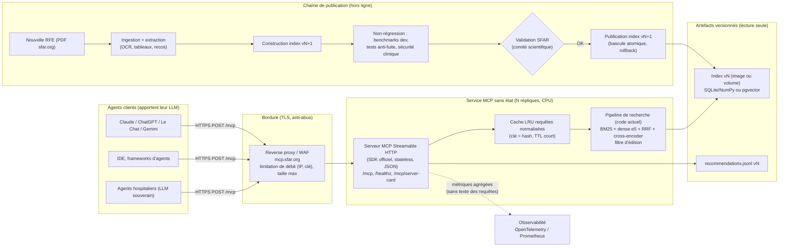

# Serveur MCP public des recommandations SFAR — faisabilité, pertinence, architecture

Date : 2026-11-27. Auteur : sous-agent architecture (branche `rag-sfar-v2`).
Public visé : décideur SFAR (sections 1, 4, 6) et développeur (sections 2, 3, 5).

Légende utilisée dans tout le document :
- **[V]** : vérifié, avec la source et la date (liste en section 7) ;
- **[M]** : mesuré dans ce dépôt (commande ou rapport cité) ;
- **[H]** : hypothèse ou recommandation non vérifiée, à valider.

---

## 1. Verdict

**Faisable : oui, techniquement simple.** Le protocole est stabilisé. La révision MCP du 2026-07-28 rend le transport HTTP sans état : plus de session ni de poignée de main obligatoire, et chaque requête peut aller à n'importe quelle réplique derrière un répartiteur de charge [V1, V2]. Le SDK Python officiel (`mcp` 2.3.0) sert sur le même point d'accès les clients récents (2026-07-28) et les anciens (2024-11-05 à 2025-11-25) [M : `tests/test_mcp_http.py`]. Notre pipeline tient sur un CPU. Mesure sur portable via HTTP MCP, index réel (265 documents, 33 300 passages, reranker actif) : **médiane 220 ms par recherche**, environ 10 à 12 000 caractères (≈ 3 000 tokens) pour 8 extraits [M : smoke test, §5]. Les principaux assistants savent appeler un serveur MCP distant : Claude, ChatGPT, Le Chat, Gemini (Enterprise, API, CLI, application selon les pays) [V5–V9].

**Pertinent : oui, pour un usage précis.** Le serveur doit être un **moteur de recherche cité, en lecture seule**, sur la doctrine SFAR. Il ne doit pas être un « assistant qui répond ». Trois raisons :

1. **L'argument principal tient.** Nos mesures montrent que le goulot d'étranglement est le générateur, pas la recherche [M, `JOURNAL.md`, 2026-11-26]. Sur les mêmes passages, un 7B local fait 69 % (jeu multi-RFE) et 81 % (ABP, questions humaines) de réponses correctes ; Sonnet en fait 90–91 % avec 6 passages et 95–97 % avec 12. Les erreurs graves passent de 4–16 % à 0–2 %. Avec MCP, c'est le modèle de l'agent client, souvent un modèle fort, qui rédige. La SFAR fournit les preuves, pas le raisonnement.
2. **Sécurité clinique.** Fournir des extraits verbatim avec leur statut d'édition explicite (`en_vigueur` / `remplacee`) protège mieux contre la réponse obsolète que ce qui existe aujourd'hui. Aujourd'hui, un agent généraliste répond de mémoire, ou après une recherche web qui mélange les éditions.
3. **Cadre réglementaire plus simple [H].** Un service qui ne fait que retrouver et citer des textes publiés, sans produire de conclusion propre au patient, a plus de chances de rester hors du champ « dispositif médical logiciel ». Le guide MDCG 2019-11 rev.1 (juin 2025) fait reposer la qualification sur la finalité revendiquée [V14]. Une génération côté serveur (« la SFAR répond ») rapprocherait le service de l'aide à la décision. **Avis juridique à obtenir.**

**Limites, à dire franchement :**

- **La SFAR ne contrôle plus la réponse finale.** On ne maîtrise ni le prompt de l'agent, ni son modèle, ni ses erreurs de lecture (troncature, mélange de deux extraits, oubli du statut « remplacée »). Un agent faible (petit modèle local, 7B) fera les mêmes erreurs qu'aujourd'hui (69–81 %). Le serveur réduit ce risque par la structure de ses sorties (§2.4), il ne le supprime pas.
- **Pas d'abstention fiable côté serveur, aujourd'hui.** Une question hors corpus (« recette de la tarte tatin ») renvoie quand même 8 passages [M]. Le score du cross-encoder sépare nettement les cas sur 5 essais (0,00–0,05 hors sujet, 0,69–0,98 dans le sujet) [M, anecdotique]. Il faut le **calibrer sur les questions hors corpus du jeu interne** avant d'exposer un indicateur « couvert / non couvert ».
- **Couverture des clients inégale.** Le Chat ne gère ni les ressources ni les prompts MCP [V7]. ChatGPT traite comme « écriture » tout outil sans `readOnlyHint` et demande alors une confirmation [V5]. Concevoir pour le plus petit dénominateur commun : **des outils uniquement**.
- **Droits sur les textes.** Les RFE récentes paraissent dans *Anaesthesia Critical Care & Pain Medicine* (Elsevier). Plusieurs sont sous CC BY 4.0, mais la licence varie selon l'article [V16]. Diffuser des extraits verbatim à grande échelle demande l'**accord écrit de la SFAR**, et de l'éditeur si nécessaire (§4.3).

**Usages visés.** Par ordre de priorité :
1. Agents d'IDE et assistants de cliniciens qui veulent des **preuves citées** (Claude, ChatGPT, Le Chat).
2. Agents hospitaliers internes : ils branchent le serveur sur leur propre LLM souverain, ce qui évite d'héberger un générateur à la SFAR.
3. Autres équipes du datathon et chercheurs, pour une évaluation reproductible.

**Non visés :** la décision automatique sans humain, et tout usage avec des données identifiantes de patient.

---

## 2. Spécification des outils (côté agent consommateur)

### 2.1 Principes

- **Retrieval seulement, pas de génération côté serveur** (décision recommandée). Le serveur renvoie des preuves ; l'agent rédige. Un outil « réponse rédigée » aurait quatre défauts :
  1. il déplacerait la responsabilité médicale vers la SFAR ;
  2. il coûterait un GPU et un modèle ;
  3. il serait moins bon que les modèles des clients (cf. 69–81 % vs 90–97 %) ;
  4. il exposerait un vecteur d'injection de plus.

  Si la SFAR veut une réponse rédigée pour son propre site, c'est un produit séparé (l'API `/api/query` existante), pas une partie du MCP.
- **Peu d'outils, chacun bien nommé** : 6 outils au plus. Les clients injectent toute la liste dans le contexte du modèle, et la spécification recommande un ordre déterministe pour le cache [V2, V3].
- **Tous en lecture seule** : `readOnlyHint: true`, `destructiveHint: false`, `idempotentHint: true`, `openWorldHint: false`. Sans `readOnlyHint`, ChatGPT demande une confirmation à chaque appel [V5].
- **Sortie double.** `structuredContent` conforme à un `outputSchema`, plus le même contenu sérialisé en texte, comme la spécification le recommande pour les clients qui ignorent `structuredContent` [V3].
- **Citations stables.** `doc_id` + `section` + `url` sfar.org, et `index_id` (version de l'index) dans chaque réponse. Le `doc_id` actuel dépend d'une heuristique d'année (audit §5.2). Il faut **le geler avant publication**, avec une table de correspondance publiée en cas de changement.
- **Les extraits sont des données.** Le serveur ne place jamais de texte impératif dans les extraits. L'avis d'usage est un champ séparé et figé.

### 2.2 Jeu d'outils cible

Schémas abrégés : les champs de citation sont factorisés dans `$defs/Passage`. Tous les schémas suivent JSON Schema 2020-12, le dialecte par défaut de MCP 2026-07-28 [V3].

**`$defs/Passage`** (identique pour tous les outils qui renvoient des extraits) :
```json
{
  "type": "object",
  "required": ["ref","doc_id","title","doc_type","year","status","section","passage_type","url","excerpt","truncated"],
  "properties": {
    "ref":            {"type":"string", "description":"Étiquette locale S1..Sk"},
    "doc_id":         {"type":"string"},
    "title":          {"type":"string"},
    "doc_type":       {"type":"string", "description":"RFE, RPP, préconisation…"},
    "year":           {"type":["integer","null"]},
    "version":        {"type":["string","null"], "description":"ex. V3.1"},
    "status":         {"enum":["en_vigueur","remplacee"]},
    "superseded_by":  {"type":["string","null"], "description":"doc_id de l'édition qui la remplace"},
    "section":        {"type":"string"},
    "passage_type":   {"type":"string", "description":"prose | table_row_card | table_markdown | recommendation_box | callout_*"},
    "grades":         {"type":"array","items":{"type":"string"}, "description":"Force GRADE détectée (G1+, G2+, avis d'experts…)"},
    "recommendation_ids": {"type":"array","items":{"type":"string"}},
    "url":            {"type":"string","format":"uri", "description":"Page sfar.org du document"},
    "excerpt":        {"type":"string", "description":"Texte VERBATIM"},
    "truncated":      {"type":"boolean"},
    "is_context_expansion": {"type":"boolean"},
    "relevance":      {"type":["number","null"], "description":"Score brut du reranker, non calibré"}
  }
}
```

| # | Outil | Entrée | Sortie structurée | Budget | Hors corpus / prudence |
|---|---|---|---|---|---|
| 1 | `sfar_search` **(prototype livré)** | `query` (3–1000 car., sans donnée identifiante), `top_k` (1–20, déf. 8), `include_superseded` (déf. false), `max_chars_per_passage` (200–6000, déf. 1800) | `{query, index_id, passages:[Passage], contains_superseded, usage_notice}` | ≈ 3 k tokens à 8 extraits [M], ≤ 10 k au maximum | Aujourd'hui, `relevance` est fourni brut. **Cible** : `coverage: "couvert" \| "incertain" \| "non_couvert"` après calibration. Pas d'extraits en dessous d'un seuil, avec un message fixe « Le corpus SFAR ne traite pas explicitement cette question ». |
| 2 | `sfar_get_recommendation` | `unit_id` ou (`doc_id` + `reco_label`, ex. « R1.2 ») | `{recommendation:{unit_id, doc_id, title, year, status, reco_label, statement (verbatim), strength, strength_raw, agreement, section, url}, siblings:[unit_id]}` | < 1 k tokens | `isError` si identifiant inconnu, avec indication pour corriger. Source : `data_derived/recommendations.jsonl` (3 933 unités, précision manuelle 92,5 %) [M]. Ne pas l'exposer avant d'avoir réduit les 1 206 forces `unknown`. |
| 3 | `sfar_get_section` | `doc_id`, `section` (chemin exact ou préfixe), `max_chars` (≤ 20 000) | `{doc_id, title, year, status, url, section, passages:[Passage] ordonnés, truncated}` | ≤ 6 k tokens | Sert à lire un **tableau de posologie complet** ou une section entière, plutôt que des fragments. Remplace `get_recommendation_sections`. |
| 4 | `sfar_compare_editions` | `topic` (texte) ou `lineage_id`, `top_k_per_edition` (déf. 3) | `{lineage_id, editions:[{doc_id, year, version, status, passages:[Passage]}] du plus récent au plus ancien}` | ≤ 6 k tokens | Avertissement structurel : seules les éditions `en_vigueur` font foi. Ne fonctionne que pour les documents qui ont une lignée (94/264 aujourd'hui, audit 01 §3). Il faut le dire dans la description. |
| 5 | `sfar_catalog` | `keyword?`, `domain?`, `status?` (`en_vigueur` / `toutes`), `cursor?` | `{items:[{doc_id, title, doc_type, year, version, status, superseded_by, domains, url}], next_cursor}` | ≤ 2 k tokens par page | Liste paginée, `ttlMs` élevé (cache) [V2]. |
| 6 | `sfar_check_coverage` (optionnel) | `query` | `{coverage, best_documents:[{doc_id,title,year,status,url}], note}` | < 300 tokens | Réponse « est-ce couvert ? » peu coûteuse, sans extraits. N'a de sens qu'avec un seuil calibré. À défaut, ne pas l'exposer. |

Outils à **ne pas** exposer : `answer`/`ask` (génération), écriture, feedback libre (risque de données patient), `sampling` (déprécié [V1]).

**Rétrocompatibilité.** Les 4 outils du serveur stdio (`search_sfar_recommendations`, `compare_sfar_editions`, `list_sfar_catalog`, `get_recommendation_sections`) restent servis tels quels, avec la sortie texte de `format_context_for_llm`, tant que d'autres équipes s'en servent. Les nouveaux noms préfixés `sfar_` évitent les collisions quand un agent agrège plusieurs serveurs, comme la spécification le recommande [V3].

### 2.3 Ressources et prompts MCP : utiles ou non ?

- **Ressources** (`sfar://catalog`, `sfar://doc/{doc_id}`). Elles sont élégantes, mais Le Chat ne les gère pas [V7], et plusieurs clients ne les exposent pas au modèle sans action de l'utilisateur. **Verdict : secondaire.** On peut les ajouter plus tard pour les clients qui les gèrent (IDE), à condition que tout soit **aussi** accessible par des outils. Les outils peuvent renvoyer des `resource_link` vers la page sfar.org [V3].
- **Prompts** (gabarit « réponse clinique citée »). Ce sont des modèles que l'**utilisateur** choisit, pas le modèle, et Le Chat ne les gère pas [V7]. **Verdict : utile, mais pas suffisant.** Il faut publier un prompt `sfar_reponse_citee` (règles : répondre d'abord, citer `[doc_id §section]`, signaler les éditions remplacées, s'abstenir si rien d'explicite). Il faut **aussi** dupliquer l'essentiel dans `instructions` (côté serveur) et dans le champ `usage_notice` de chaque résultat. C'est la seule partie que tous les agents voient.

### 2.4 Rendre les sorties robustes à un agent faible

Ces mesures découlent de nos échecs observés sur le 7B : troncature du contexte, mélange d'éditions, abstention manquée.

1. **L'ordre compte.** Les extraits `en_vigueur` viennent avant les `remplacee`, puis le classement par pertinence. Pas de réordonnancement « en U » : il n'est pas soutenu par la littérature, voir l'audit 01.
2. **Le statut est répété là où il sert.** Le champ `status` figure sur chaque extrait, et la version texte commence chaque bloc par `[EN VIGUEUR]` / `[REMPLACÉE par …]`. Une redondance utile.
3. **Des tableaux entiers plutôt que des lignes isolées** quand la question porte sur une posologie. `sfar_get_section` renvoie le tableau complet avec ses en-têtes, ce qui évite qu'un agent lise une ligne hors contexte.
4. **Peu d'extraits par défaut** (8) et une troncature signalée par `truncated: true`. Avec un modèle fort, 12 extraits améliorent la justesse (+4 à +6 pts, significatif) [M]. Le paramètre `top_k` laisse l'agent fort en demander plus.
5. **Avis d'usage figé et court** dans chaque résultat. Les extraits ne contiennent jamais d'instructions.
6. **Erreurs exploitables.** Une erreur d'outil `isError: true` explique comment corriger, par exemple « `top_k` doit être entre 1 et 20 », pour que le modèle se corrige [V3].

---

## 3. Architecture cible

### 3.1 Schéma



### 3.2 Composants

| Composant | Choix recommandé | Justification |
|---|---|---|
| Transport | Streamable HTTP, `stateless_http=True`, réponses JSON (pas de SSE) | 2026-07-28 : sans session, routage simple [V1, V4]. Aucun besoin de notifications : outils courts, liste fixe. |
| SDK | `mcp` ≥ 2.3 (Python, officiel, MIT) | Sert les révisions 2024-11-05 → 2026-07-28 sur un seul point d'accès [M]. Gère les en-têtes `Mcp-Method`/`Mcp-Name` et la validation d'`Origin` [V4]. |
| Recherche | Le pipeline C9 actuel (BM25 + dense + RRF + reranker + filtre d'édition) | Seuls le dense et le reranker apportent un gain mesuré [M, ablation du 26/11]. |
| Index | Artefact **immuable versionné** (`index_id`), chargé en mémoire au démarrage (531 Mo aujourd'hui [M]) ; pgvector en option | Une seule source de vérité par version, bascule et retour arrière atomiques. pgvector ne s'impose pas à cette taille (33 k passages) [H]. |
| Cache | LRU en mémoire par réplique (requête normalisée → résultat), TTL de quelques heures, purgé à chaque nouvel index | Les questions cliniques se répètent beaucoup [H]. Pas de cache partagé, donc pas de stockage de requêtes. |
| Découverte | Server Card à `https://mcp.sfar.org/mcp/server-card`, catalogue `/.well-known/ai-catalog.json` sur sfar.org, inscription au registre MCP officiel sous un espace de noms vérifié par DNS (`org.sfar/…`) | SEP-2127 finalisé (créé le 21/01/2026) ; emplacement recommandé `<url>/server-card` [V10]. Registre : vérification par DNS ou HTTP [V11]. Le chemin `.well-known` exact doit être vérifié dans le dépôt de l'extension au moment de publier [V10]. |

### 3.3 Dimensionnement [H, à confirmer par test de charge]

- Mesure [M] : 176–220 ms par recherche après le premier appel (≈ 940 ms à froid), sur CPU de portable, le cross-encoder étant le poste dominant. Un cœur traite donc environ 4 à 5 requêtes par seconde.
- **Pas de GPU nécessaire** pour la version actuelle (e5-small + mMiniLM). Deux répliques de 2 vCPU / 4 Go suffisent pour des centaines d'utilisateurs actifs. Un GPU ne se justifie que pour un reranker lourd (bge-reranker-v2-m3 : 13 s par requête sur Mac, gain non significatif [M]).
- Coût d'exploitation [H] : 2 petites VM ou 2 conteneurs, de l'ordre de 50 à 150 €/mois hors temps humain. Aucun coût de LLM côté serveur, puisque la génération est chez le client.

### 3.4 Hébergement

| Option | Pour | Contre | Avis |
|---|---|---|---|
| **A. `mcp.sfar.org` (DNS SFAR), service hébergé chez un hébergeur souverain (LibreDataHub / InterHop ou cloud FR), le site WordPress restant à part** | Identité SFAR, ce qui limite l'usurpation ; isolation du WordPress ; souveraineté | Contrat d'hébergement, astreinte | **Recommandé** |
| B. Dans l'hébergement WordPress de sfar.org | Simplicité administrative | WordPress/PHP mal adapté à un service Python avec modèles en mémoire ; surface d'attaque partagée | Déconseillé |
| C. LibreDataHub seul, sous un domaine tiers | Rapide pour le datathon | Les agents et les cliniciens ne peuvent pas vérifier que c'est la SFAR ; risque d'usurpation | Pilote uniquement |

**HDS.** La certification HDS s'impose à qui héberge des **données de santé à caractère personnel** pour le compte d'un tiers [V15]. Le service ne traite **pas** de données patient par conception. Mais une requête libre peut contenir un élément clinique (« patient de 82 ans, DFG 25… »), voire un identifiant si l'utilisateur en colle un. Mesures : ne jamais conserver le texte des requêtes (§4.2), l'interdire explicitement dans la description des outils et les CGU, et filtrer les motifs évidents (NIR, nom/prénom + date de naissance) en refusant la requête. Avec ces mesures, un hébergement non HDS paraît défendable [H]. **À faire valider par le DPO de la SFAR.**

### 3.5 Mise à jour du corpus

1. Une nouvelle RFE paraît : ingestion dans un **nouveau** dossier d'index (règle déjà en vigueur dans le projet). Marquage de l'édition remplacée (lignée).
2. Non-régression automatique : rejeu des benchmarks dev (`abpe171`, `multirfe_synth`), des tests de sécurité (édition obsolète présentée comme en vigueur, abstention) et du test anti-fuite. **Seuils bloquants** : pas de baisse du *passage hit* au-delà de l'IC, 0 extrait `remplacee` sans statut. Plus un contrôle propre à la RFE ajoutée : 10 à 20 questions écrites par un expert.
3. Validation humaine (§4.4), puis bascule atomique de `index_id`, avec retour arrière possible.
4. `index_id` est exposé dans chaque réponse, ce qui permet de rattacher une plainte à une version précise.

### 3.6 Observabilité sans données sensibles

- On journalise : horodatage, outil, `index_id`, latence, nombre d'extraits, `coverage`, code d'erreur, version du protocole, `clientInfo.name` (Claude, ChatGPT…), IP **tronquée** ou hachée avec un sel tournant.
- On ne journalise **pas** : le texte de la requête ni les extraits renvoyés. Pour améliorer le moteur, prévoir un **échantillonnage opt-in** séparé (clé d'établissement, consentement, purge sous 30 jours), et seulement après avis du DPO.
- Traçage OpenTelemetry, dont la propagation dans `_meta` est documentée depuis 2026-07-28 [V1]. Pas d'attributs contenant la requête.

### 3.7 Authentification et limitation de débit

- **Palier public anonyme** en lecture : c'est la politique « aucune authentification » permise par la spécification, où l'autorisation est OPTIONNELLE [V12]. Les grands clients la gèrent : « No sign-in » chez Claude, « No authentication » chez ChatGPT et Le Chat [V5–V7]. Quota par IP (ex. 30 requêtes/min, 2 000/jour) [H].
- **Palier établissements** : quotas plus larges, échantillonnage de requêtes possible, support. Deux options :
  - le plus simple, un **jeton porteur** statique dans un en-tête, accepté par Claude, Le Chat et ChatGPT [V5–V7] ;
  - pour aller plus loin, **OAuth 2.1** avec *Protected Resource Metadata* (RFC 9728) et métadonnées client CIMD. Le DCR est déprécié depuis 2026-07-28 [V1, V12].
- Taille maximale des requêtes, `top_k ≤ 20`, délai d'expiration par appel, et un seul calcul simultané par processus (déjà dans le prototype).

---

## 4. Sécurité, juridique, gouvernance

### 4.1 Menaces techniques

| Menace | Vecteur | Contre-mesure |
|---|---|---|
| **Injection de prompt via le contenu** | Le texte des extraits arrive dans le contexte de l'agent. Le corpus SFAR est fiable, mais l'OCR et les mises à jour pourraient introduire du texte parasite [V13]. | Corpus fermé et validé. Champ `usage_notice` séparé, plus « le texte est une donnée ». Scan de motifs impératifs (« ignore… », « appelle l'outil… ») à l'ingestion. Aucun outil d'écriture ni d'accès réseau : le serveur n'a rien de dangereux à exécuter. |
| **Empoisonnement d'outils / « rug pull »** | Descriptions d'outils modifiées après installation [V13] | Descriptions versionnées dans git, revues, gelées par release. Liste d'outils stable et ordonnée [V3]. |
| **Usurpation du serveur** | Faux « serveur SFAR officiel ». C'est déjà arrivé à data.gouv.fr, qui met en garde contre des serveurs non officiels [V17]. | Domaine `sfar.org`, page officielle qui renvoie vers l'URL, Server Card, inscription au registre sous l'espace de noms vérifié par DNS [V10, V11]. |
| **Abus / déni de service** | Requêtes massives, `top_k` élevé, aspiration du corpus | Quotas par IP et par clé, plafonds de paramètres, cache, WAF. Surveiller l'aspiration (fortes séquences de `get_section`). |
| **DNS rebinding** (prototype local) | Site malveillant qui vise un serveur local | Validation d'`Origin`/`Host` par le SDK (MUST [V4]), écoute sur 127.0.0.1 par défaut (prototype). |
| **Combinaison avec d'autres serveurs** | Un agent connecté à plusieurs serveurs peut exfiltrer d'un serveur vers un autre | Hors de notre contrôle. Nos outils ne reçoivent rien de sensible et n'écrivent rien. |

### 4.2 RGPD et journalisation

- Les requêtes peuvent contenir des éléments cliniques. Sans identifiant, il ne s'agit pas forcément de données personnelles, mais **le risque d'identifiant collé existe** [H].
- Principe : **minimisation**. Aucun texte de requête n'est stocké par défaut (§3.6), les IP sont tronquées, la durée de conservation est courte.
- Mention d'information sur la page du service. Registre des traitements de la SFAR. Analyse d'impact (AIPD) si l'échantillonnage opt-in est activé [H].

### 4.3 Responsabilité médicale et droits

- **Responsabilité.** La SFAR fournit des **extraits de ses propres textes**. La rédaction finale est faite par l'agent, sous sa responsabilité et celle de l'utilisateur. Messages à afficher : « information destinée aux professionnels de santé, ne remplace pas le jugement clinique ; vérifier l'édition en vigueur ». Ne **pas** revendiquer d'usage diagnostique ou thérapeutique individuel, pour rester hors du champ « dispositif médical » [H, V14].
- **Droit d'auteur.** Statut à établir document par document. Certaines RFE sont publiées en accès libre CC BY 4.0 dans ACCPM (Elsevier Masson pour la SFAR) [V16]. D'autres textes appartiennent à la SFAR ou à des co-éditeurs (SRLF, HAS…). Il faut, pour chaque document, l'autorisation de diffuser des extraits verbatim et la mention de licence et d'attribution dans la sortie (champ `license` à ajouter) [H].
- **Conditions d'utilisation** : interdiction de données identifiantes, d'usage commercial massif (selon la décision SFAR) et d'aspiration intégrale. Mention de la source obligatoire.

### 4.4 Gouvernance

- **Propriétaire du service** : la SFAR (comité scientifique ou commission des référentiels). Opérateur technique : InterHop ou un prestataire.
- **Mise à jour** : une RFE n'entre dans l'index qu'après la publication officielle sur sfar.org **et** la validation d'un référent médical. Celui-ci contrôle par échantillonnage les tableaux, le marquage de l'édition remplacée et les forces GRADE.
- **Signalement** : formulaire ou adresse dédiés, sans données patient. Chaque signalement est rattaché à l'`index_id`.
- **Évaluation continue** : rejeu des benchmarks à chaque version, rapport public des métriques de recherche et de sécurité. Les **benchmarks des experts** (projet `benchmark-enrichi`) font foi dès qu'ils sont disponibles (CLAUDE.md, principe 4 bis).

---

## 5. Écart avec l'existant et plan de migration

### 5.1 Ce que fait déjà `mcp_server.py` (stdio)

Il fait le JSON-RPC ligne par ligne, `initialize` (annonce `2024-11-05`), `tools/list` (4 outils), `tools/call` (sortie texte). Ce qui manque, d'après l'audit §3.8 et la spécification 2026-07-28 [V1–V4] :
- transport HTTP ;
- `ping` (déjà retiré en 2026-07-28, mais requis par les clients anciens) ;
- notifications sans réponse ;
- `-32700` sur JSON invalide ;
- validation des arguments ;
- `outputSchema` / `structuredContent` ;
- annotations d'outils ;
- `server/discover` et `resultType` (2026-07-28) ;
- pas de garde contre la pollution de stdout par le chargement des modèles ;
- index par défaut inexistant (`index/sota_default`) ;
- description « 267 recommandations » figée.

### 5.2 Prototype livré (nouveaux fichiers uniquement)

- `src/rag_sfar/interfaces/mcp_http.py`. Expose en Streamable HTTP (SDK officiel `mcp` 2.3.0, mode sans état, réponses JSON) :
  - les **4 outils existants** à l'identique, par délégation à `SfarMcpServer.call_tool` ;
  - l'outil prototype **`sfar_search`** avec `outputSchema` et `structuredContent` (citation complète, statut d'édition, URL sfar.org, extrait verbatim, `relevance` brut, `index_id`, `usage_notice`) ;
  - les annotations lecture seule sur tous les outils, la validation des bornes des paramètres, `/healthz`, et une écoute sur 127.0.0.1 par défaut.

  Lancement : `HF_HUB_OFFLINE=1 .venv/bin/python -m rag_sfar.interfaces.mcp_http --index-dir index/table_aware_sota --port 8765`.
- `tests/test_mcp_http.py`. Démarre le serveur sur un port libre en localhost avec un index minuscule en mémoire, puis vérifie trois choses :
  1. avec le client officiel en protocole **2026-07-28** (sans état) : `tools/list` (5 outils, tous `readOnlyHint`), `tools/call` structuré et texte, rejet de `top_k: 500` ;
  2. la même chose en mode **legacy** (`initialize`) ;
  3. un `initialize` JSON-RPC brut (client 2025-06-18).

  Le test est ignoré si `mcp` n'est pas installé.
- **Dépendance ajoutée au venv** : `mcp==2.3.0`, qui tire PyJWT, cryptography, cffi, pycparser, python-multipart, sse-starlette et `mcp-types`. Elle n'est **pas** déclarée dans `pyproject.toml`, pour ne pas toucher aux fichiers existants. À ajouter plus tard dans un extra `[mcp]`.
- Smoke test sur l'index réel via HTTP [M] : chargement en 6,7 s, médiane **219 ms** sur 5 requêtes (939 ms au premier appel), 9,7 à 12,6 k caractères pour 8 extraits. Les premiers résultats sont corrects pour ABP/PTH, apixaban, vidéolaryngoscopie et prémédication. Pour « tarte tatin », le serveur renvoie quand même 8 extraits : c'est le défaut d'abstention décrit au §1.
- **Vérification.** `.venv/bin/python -m pytest -q` : 86 tests verts, dont les 3 nouveaux (27/11, ~01 h). Pendant quelques minutes, la suite ne se chargeait pas, à cause d'une modification de `router.py` en cours par un autre agent ; c'était sans lien avec ce prototype. Aucun test n'a été fait avec un client réel (Claude, ChatGPT), car cela exige une URL publique.

### 5.3 Plan par étapes

Chaque étape est courte, sans rupture du stdio. Effort en jours-personne [H].

| Étape | Contenu | Effort | Critère de sortie |
|---|---|---:|---|
| 0 | ✅ Prototype HTTP local + tests (ce livrable) | fait | 3 tests verts sur client officiel, deux générations de protocole |
| 1 | Corriger le stdio sans changer ses sorties : notifications, `ping`, `-32700`, validation, stdout protégé, index par défaut. Ou le porter sur le SDK avec les mêmes 4 outils (`mcp.run("stdio")`). Tests de contrat existants inchangés. | 1 | `tests/test_rag_sfar.py::test_mcp_server_protocol` + sonde de l'audit §3.8 |
| 2 | Geler les identifiants (`doc_id` sans année, table de correspondance), champ `license` par document, `index_id` dans le manifeste | 1–2 | Identifiants stables entre deux reconstructions d'index |
| 3 | **Calibrer l'abstention** : seuil sur `relevance` à partir des questions hors corpus du jeu interne (dev). Exposer `coverage`. Mesurer faux refus et fausses couvertures avec IC. | 2 | Abstention ≥ jeu actuel, sans perte de *passage hit* |
| 4 | Outils cibles : `sfar_get_section` (tableau complet), `sfar_compare_editions` structuré, `sfar_catalog` paginé, puis `sfar_get_recommendation` après amélioration des forces `unknown` | 3–4 | Schémas validés (`outputSchema`), tests de contrat |
| 5 | **Évaluation bout-en-bout « agent via MCP »** : Sonnet/Haiku et un modèle local appellent les outils (boucle agentique), sur abpe171 dev et multirfe dev, jugés par le juge calibré. Comparer avec le générateur fixe (6/12 passages). Cela mesure l'argument central avec des agents réels. | 2–3 | Rapport avec IC ; erreurs graves ≤ référence |
| 6 | Prod-isation : conteneur, reverse proxy (TLS, quotas, taille max), journalisation minimale (§3.6), `/healthz`, Server Card, test de charge | 3–4 | 50 req/s soutenues [H], aucune requête en clair dans les journaux |
| 7 | Pilote fermé sur une URL de test (avec accord SFAR) : jetons porteurs pour 2 ou 3 établissements, essais réels dans Claude, ChatGPT (mode développeur), Le Chat et Gemini | 2 + calendrier | Grille de compatibilité par client remplie |
| 8 | Ouverture publique : `mcp.sfar.org`, registre MCP, page d'information, CGU, procédure de mise à jour (§3.5) en routine | 2 + décisions SFAR | Validation SFAR (§6) |

Total technique : environ **17 à 22 jours-personne** jusqu'à l'ouverture publique, hors délais de décision.

### 5.4 Alternatives et compléments

- **API REST + OpenAPI** : c'est déjà `/api/search` dans `api.py`. Elle est utile aux intégrateurs classiques (DPI, intranets) et aux frameworks qui consomment OpenAPI. **À garder en parallèle** : même cœur, deux façades. MCP est préférable pour les assistants grand public, qui ne savent pas appeler une API REST arbitraire sans configuration ; REST l'est pour l'intégration logicielle.
- **llms.txt** : coût quasi nul (un fichier listant les RFE en vigueur avec leurs URL), adoption et effet mesurés faibles [V18]. **Facultatif, en complément.**
- **NLWeb** (Microsoft, mai 2025) : point d'accès conversationnel sur le contenu d'un site, chaque instance étant aussi serveur MCP [V18]. Il suppose un balisage schema.org du site et génère côté serveur. **Pas nécessaire** : notre MCP couvre déjà le besoin.
- **A2A** : protocole entre agents, pour déléguer des tâches [V18]. **Pas pertinent** tant que la SFAR n'expose pas d'agent (génération), ce qu'on déconseille.

**Retours d'expérience comparables :**
- **Microsoft Learn** : serveur MCP public sans authentification (search / fetch / code samples) sur une documentation de référence, en Streamable HTTP [V19]. C'est le modèle le plus proche.
- **data.gouv.fr** : serveur MCP officiel, lecture seule, sans authentification, depuis le 25/02/2026 [V17].
- **Santé** : on trouve surtout des serveurs **communautaires** (NICE, NCCN, PubMed…), sans éditeur officiel identifié pour les recommandations cliniques [V20]. Une SFAR officielle serait **parmi les premières sociétés savantes** à le faire. C'est un atout d'image, et une responsabilité [H].

---

## 6. À valider avec la SFAR

1. **Mandat** : la SFAR veut-elle un service officiel sous `sfar.org` ? Qui en est propriétaire (comité, commission) ?
2. **Droits** : autorisation de diffuser des extraits verbatim de chaque document, mention de licence et d'attribution, cas des textes coédités (SRLF, HAS…) et des articles ACCPM non CC BY.
3. **Périmètre** : uniquement les éditions en vigueur, ou aussi les éditions remplacées (marquées) ? Inclure les traductions anglaises ?
4. **Positionnement réglementaire** : confirmer avec un juriste que le service « recherche et citation » sans génération reste hors du champ dispositif médical (MDCG 2019-11 rev.1).
5. **Données** : le DPO valide-t-il la politique de non-conservation des requêtes, l'hébergement non HDS et la mention d'information ?
6. **Hébergement et exploitation** : LibreDataHub/InterHop ou autre hébergeur souverain ; astreinte ; budget (≈ 50–150 €/mois d'infrastructure [H] + temps humain).
7. **Accès** : public anonyme avec quotas, ou réservé aux professionnels (jetons ou OAuth via un fournisseur d'identité, ex. Pro Santé Connect [H]) ?
8. **Gouvernance des mises à jour** : qui valide une nouvelle version d'index, dans quel délai après publication d'une RFE ?
9. **Communication** : texte d'avertissement, page officielle qui renvoie vers l'URL MCP (anti-usurpation), et procédure de signalement.

---

## 7. Sources

Consultées le 2026-11-27, sauf mention contraire.

- [V1] MCP, *Key Changes* 2026-07-28 (sessions supprimées, `server/discover`, MRTR, `resultType`, cache `ttlMs`, OpenTelemetry, DCR déprécié, Sampling/Roots/Logging dépréciés) — https://modelcontextprotocol.io/specification/2026-07-28/changelog.md
- [V2] Blog MCP, publication de la spécification du 28/07/2026 ; SDK Tier 1 (TS, Python, Go, C#) compatibles — https://blog.modelcontextprotocol.io/posts/2026-07-28/
- [V3] MCP 2026-07-28, *Tools* (`outputSchema`, `structuredContent` + TextContent recommandé, annotations non fiables par défaut, ordre déterministe, erreurs `isError`, sécurité : valider, limiter le débit, assainir) — https://modelcontextprotocol.io/specification/2026-07-28/server/tools.md
- [V4] MCP 2026-07-28, *Streamable HTTP* (point d'accès unique POST, `Origin` MUST, localhost SHOULD, en-têtes `MCP-Protocol-Version`/`Mcp-Method`/`Mcp-Name`, rétrocompatibilité) — https://modelcontextprotocol.io/specification/2026-07-28/basic/transports/streamable-http.md
- [V5] OpenAI, *ChatGPT Developer mode* (SSE et streaming HTTP ; OAuth, sans authentification ou mixte ; outils sans `readOnlyHint` traités comme écriture ; pas d'obligation `search`/`fetch`) ; page non datée — https://developers.openai.com/api/docs/guides/developer-mode.md
- [V6] Anthropic, *custom connectors using remote MCP* (tous plans y compris Free, limité à 1 ; sans connexion, OAuth ou en-têtes de requête ; connexion depuis le cloud Anthropic). Les sources se contredisent sur l'offre Free — https://support.claude.com/en/articles/11175166 ; https://claude.com/docs/connectors/custom/remote-mcp.md
- [V7] Mistral, *MCP Connectors* (sans authentification, Bearer/Basic, OAuth 2.1 ; ajout par un administrateur ; pas de ressources ni de prompts) ; page non datée, annonce du 02/09/2025 — https://docs.mistral.ai/le-chat/knowledge-integrations/connectors/mcp-connectors ; https://mistral.ai/news/le-chat-mcp-connectors-memories
- [V8] Google Workspace Updates, 15/09/2026 (connecteurs tiers dans Gemini pour Workspace) — https://workspaceupdates.googleblog.com/2026/09/connect-to-more-tools-with-gemini-in-Google-Workspace.html
- [V9] Google Cloud, *Configure MCP in an AI application* (Gemini API et Enterprise : Streamable HTTP uniquement) — https://docs.cloud.google.com/mcp/configure-mcp-ai-application. Le détail de l'application grand public vient de sources secondaires, à revérifier.
- [V10] SEP-2127 *MCP Server Cards* (Final, créé le 21/01/2026 ; `<streamable-http-url>/server-card` ; AI Catalog `/.well-known/ai-catalog.json`) — https://modelcontextprotocol.io/seps/2127-mcp-server-cards.md
- [V11] MCP Registry (vérification de l'espace de noms par GitHub, DNS ou HTTP) — https://modelcontextprotocol.io/registry/about.md. Statut GA non confirmé.
- [V12] MCP 2026-07-28, *Authorization* (OPTIONNELLE ; si implémentée : OAuth 2.1, RFC 9728 MUST, RFC 8707, audience des jetons, pas de passthrough, CIMD) — https://modelcontextprotocol.io/specification/2026-07-28/basic/authorization.md
- [V13] OWASP MCP Top 10 (brouillon : empoisonnement d'outils, injection par charges contextuelles…) — https://owasp.org/www-project-mcp-top-10/ ; OWASP MCP Security Cheat Sheet — https://cheatsheetseries.owasp.org/cheatsheets/MCP_Security_Cheat_Sheet.html
- [V14] Commission européenne, MDCG 2019-11 rev.1, juin 2025 (qualification du logiciel selon la finalité revendiquée) — https://health.ec.europa.eu/latest-updates/update-mdcg-2019-11-rev1-qualification-and-classification-software-regulation-eu-2017745-and-2025-06-17_en. Le passage précis sur les outils de recherche documentaire n'a **pas** été lu.
- [V15] ANS, champ d'application de l'hébergement de données de santé (art. L.1111-8 CSP) — https://esante.gouv.fr/faq/quel-est-le-champ-dapplication-de-la-legislation-relative-lhebergement-de-donnees-de-sante-caractere-personnel
- [V16] Exemple de RFE SFAR en CC BY 4.0 dans ACCPM (intubation difficile, 2018) — https://pubmed.ncbi.nlm.nih.gov/31866309/ (via résultats de recherche ; la licence varie selon l'article).
- [V17] data.gouv.fr, serveur MCP officiel expérimental (25/02/2026, lecture seule, sans authentification, alerte sur les serveurs non officiels) — https://www.data.gouv.fr/posts/experimentation-autour-dun-serveur-mcp-pour-datagouv
- [V18] NLWeb (Microsoft, Build, 19/05/2025) — https://github.com/microsoft/NLWeb ; llms.txt (adoption et effet faibles, sources secondaires : SE Ranking, blogs) ; A2A vs MCP (sources secondaires) — https://microsoft.github.io/ai-agents-for-beginners/11-agentic-protocols/
- [V19] Microsoft Learn MCP Server (public, sans authentification, Streamable HTTP, `https://learn.microsoft.com/api/mcp`) — https://learn.microsoft.com/training/support/mcp ; https://github.com/MicrosoftDocs/mcp
- [V20] Serveurs MCP santé communautaires (NICE, NCCN, PubMed…) — https://github.com/rdmgator12/awesome-healthcare-mcp-servers. Annuaire communautaire, non vérifié.

Mesures internes [M] : `JOURNAL.md` (26/11/2026 : générateur 7B vs Sonnet, ablation retrieval C9, reranker bge), `reports/agents/audit_code_ingestion_generation.md` §3.8 et §5, `reports/01_audit.md`, smoke test du prototype sur `index/table_aware_sota` (27/11/2026, script non versionné : 5 requêtes via le client MCP officiel en 2026-07-28).
